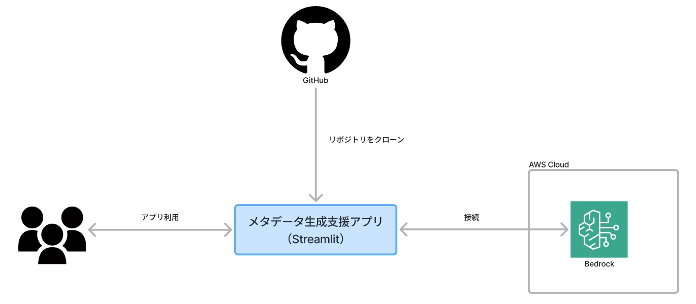
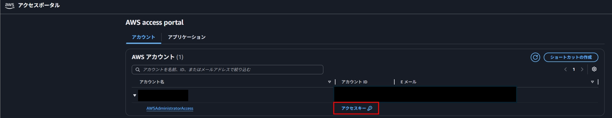
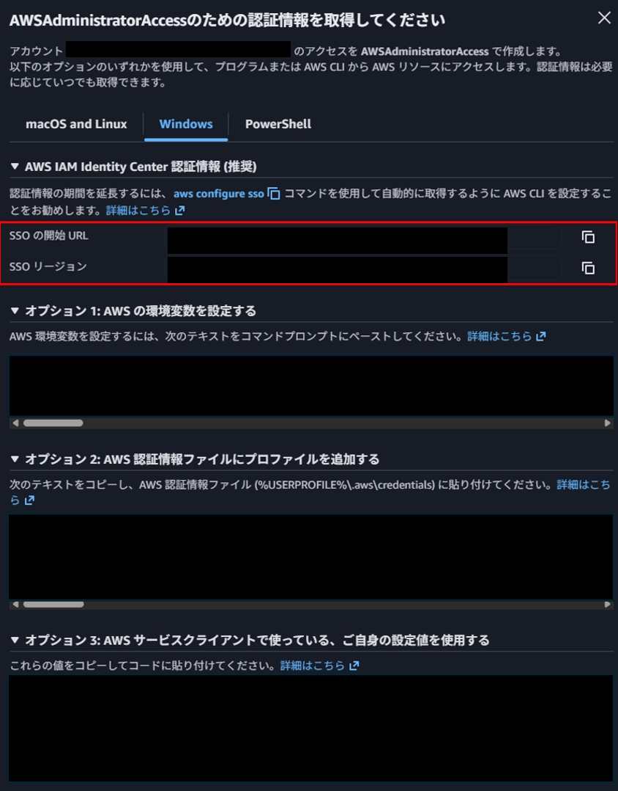
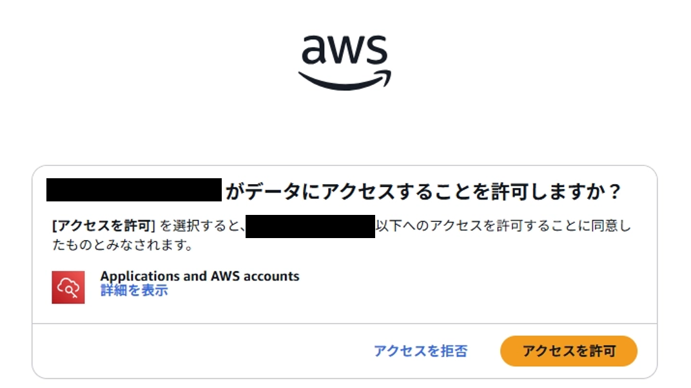
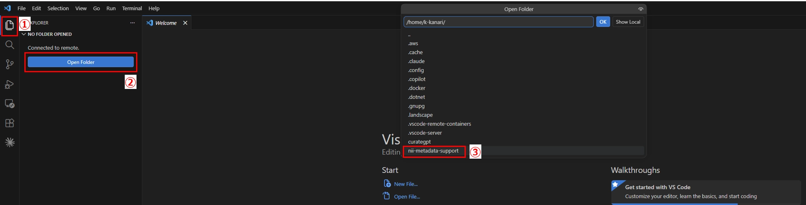
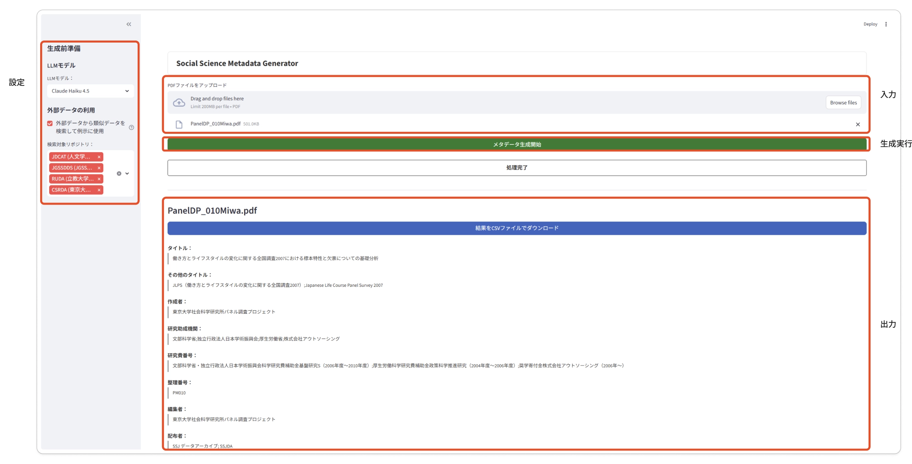

# 本リポジトリについて

本リポジトリに格納されているソースコードは、「社会科学分野メタデータ生成支援に関する AI 活用 PoC 技術検証」の技術的実現性の検証にて構築したメタデータ生成支援アプリのソースコードである。

本READMEでは、ローカルの開発環境にてメタデータ生成支援アプリを構築する手順を記載している。

# 概要

本構築手順書はメタデータ生成支援アプリを利用するユーザーが、アプリを構築・利用でき、メタデータを生成できることを目的としている。

構築するメタデータ生成支援アプリの全体像は以下である。



# メタデータ生成アプリの構築手順

## **構築する上での前提条件**

### **インストールが必要なソフトウェア**

以下のソフトウェアがPCにインストールされていること

- VS Code（Version：1.119.0）
- WSL（Version：2.6.3.0）

また、VSCodeには以下の拡張機能がインストールされていること

- Dev Containers（Version：0.459.0）

### **AWSとの接続に必要な条件**

- 利用するAWSアカウントがAmazon Bedrockへのアクセス権を持っていること
- AWS CLI（Version：2.34.44）を利用できること
- Amazon Bedrockにて、以下のモデルが利用可能であること
    - Claude Haiku 4.5
    - Claude Sonnet 4.5
    - Claude Sonnet 4.6

Claudeモデルが利用できない場合は、AWSアカウントでClaudeの利用が有効化されていないため、以下を参照し、有効化してください。

## **環境構築手順**

### **1. WSLへ接続**

1. VS Code 左下の `><` アイコンをクリック
2. 「ディストリビューションを使用してWSLに接続」 を選択する。
3. 「**Ubuntu**」を選択する。※Ubuntuのバージョンは26.04

### **2. AWSへの接続情報の設定**

ターミナルを開き、カレントディレクトリで以下のコマンドを実行し、AWSとの接続情報を設定する。

ただし、今回に関してはSSOによる設定方法を説明する。

※SSO start URLとSSO regionについては、以下の入力内容を参考にする。

- SSO start URLとSSO regionの入力内容
    
    SSO start URLとSSO regionには、アクセスポータル内のアクセスキーを押下したら表示される、「SSOの開始URL」と「SSOリージョン」を入力する。
    
    
    
    
    

```powershell
## AWSへのSSO設定の作成
aws configure sso
 
SSO session name：任意のセッション名
SSO start URL：AWS IAM Identity Center 認証情報の開始URL
SSO region：AWS IAM Identity Center 認証情報のリージョン
SSO registration scopes：入力せずにEnterを押下する。
表示されるURLにアクセスし、「アクセスを許可」を押下　
※リンク押下後に表示される画面は本コードブロックの下の画像

CLI default Region：BedRockを利用するリージョン
CLI profile name：任意の名前
```



### **3. リポジトリをクローン**

ターミナルを開き、カレントディレクトリで以下のコマンドを実行し、リポジトリをクローンする。

```
git clone <リポジトリURL>
```

クローン後、以下の順序に従って、VSCodeの画面を操作する。



### **4. Dev Container で起動**

1. VS Code 左下の `><` アイコンをクリック 
2. **「Reopen in Container」** を選択する。

初回はDockerイメージのビルドが実行されるため数分かかる。

### **5. AWSへのログイン**

以下のコマンドを実行し、AWSへログインする。

```
aws sso login --profile "aws configure ssoでCLI profile nameに設定した名前"
```

**5. アプリの起動**

```
uv run streamlit run metadata_support/src/metadata_support/app/app_custom_no_vector.py
```

ブラウザで `http://localhost:8502` が自動的に開く。
起動しない場合は、Webページをリロードしてください。

# **アプリの操作方法**

### UI画面の構成について



### メタデータ生成までの操作手順

1. PDFファイルをアップロード
2. サイドバーで設定を調整：
    - **LLMモデル**
    メタデータ生成に利用するLLMモデルを選択
        - Claude 4.5 Haiku
        - Claude 4.5 Sonnet
        - Claude 4.6 Sonnet（推奨）
    - 外部リポジトリ検索
    「外部データを利用」をチェックすることで外部データを利用可能
        - 以下の4つの外部データから利用する外部データを選択する。
            - JDCAT
            - JGSSDDS
            - RUDA
            - CSRDA
3. 「メタデータ生成開始」ボタンを押す
4. 生成完了後、CSVでダウンロード

# ログ出力仕様

## 出力先ディレクトリ

メタデータ生成ボタン押下ごとに、直下のoutputフォルダにタイムスタンプ付きディレクトリが新規作成され、その中に8ファイルが書き込まれる。

```
output/{YYYYMMDD_HHMMSS}/
```

## 出力ファイル一覧

| No | ファイル名 | 主な内容 |
| --- | --- | --- |
| 1 | log1_settings.txt | 設定パラメータ・LLMトークン使用量・料金 |
| 2 | log2_chunks.txt | チャンク分割結果 |
| 3 | log3_field_matching.txt | 各メタデータ項目にマッチしたチャンク一覧 |
| 4 | log4_llm_prompt.txt | 項目別メタデータ生成のプロンプト/レスポンス |
| 5 | log5_split_prompt.txt | 各チャンクに該当する生成項目 |
| 6 | log6_vocab_prompt.txt | 統制語彙変換のプロンプト/レスポンス |
| 7 | log7_jdcat_search.txt | 外部リポジトリ検索（JDCat / BM25 / LLM再ランキング） |
| 8 | log8_survey_name.txt | 調査名の抽出結果 |
